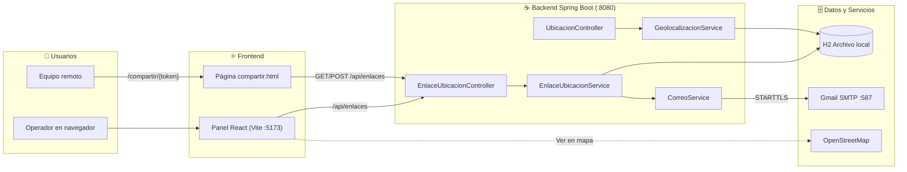
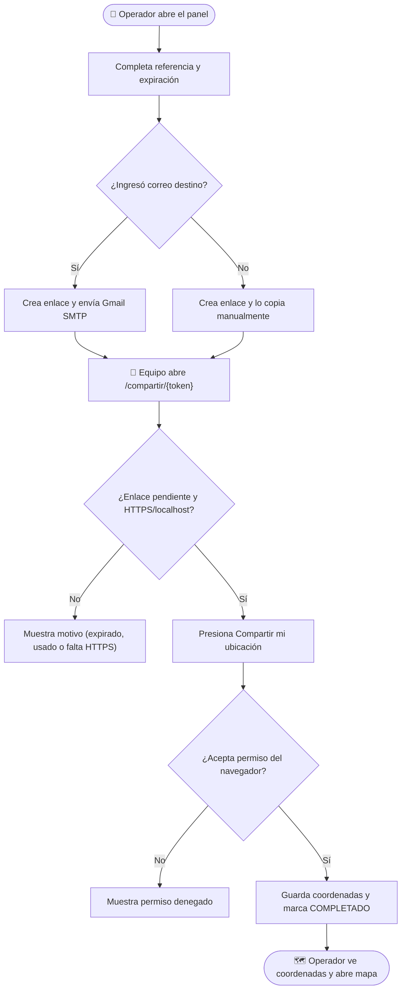
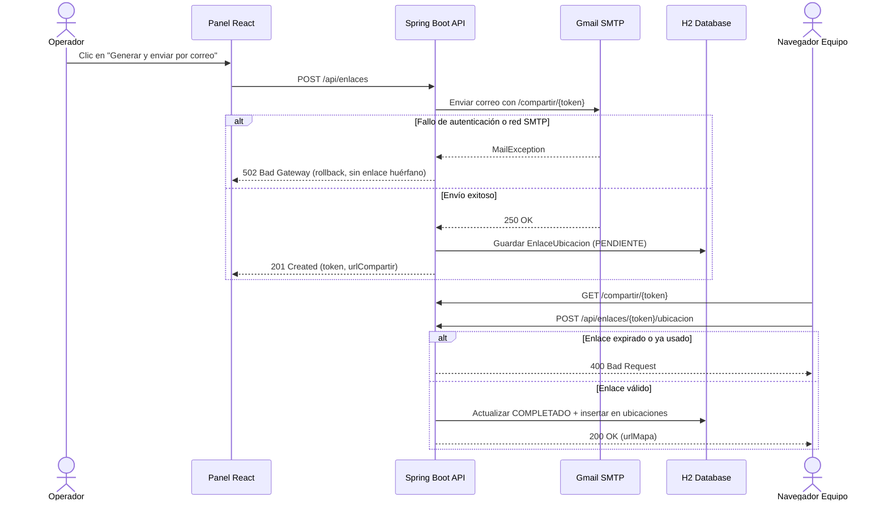
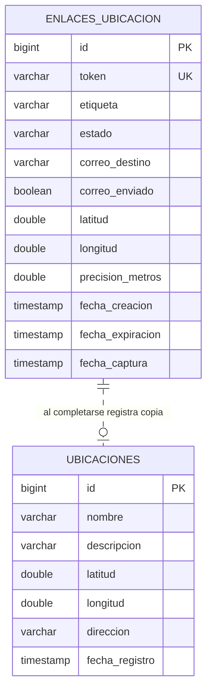

<div align="center">

# 📍 Geolocalizador

**Solicita, registra y consulta la ubicación de un equipo mediante enlaces de un solo uso con consentimiento explícito del navegador.**

Aplicación full-stack (Spring Boot + React) diseñada para generar enlaces temporales, enviarlos automáticamente por Gmail SMTP y registrar coordenadas precisas con visualización directa en OpenStreetMap.

<p>
  
  
  
  
  
</p>

<p>
  
  
  
  
</p>

[En 30 segundos](#-el-proyecto-en-30-segundos) · [Capturas](#-capturas) · [Funcionalidades](#-funcionalidades) · [Tecnología](#-tecnología) · [Mapas del sistema](#-mapas-del-sistema) · [Instalación](#-instalación) · [Manual de uso](#-manual-de-uso) · [Seguridad](#-seguridad) · [Pruebas](#-calidad-y-pruebas)

</div>

---

## ⚡ El proyecto en 30 segundos

| Dimensión | Resumen |
| :--- | :--- |
| **El problema** | Confirmar dónde está un equipo en terreno, validar una entrega o asistir a un usuario remoto suele implicar pasos manuales propensos a error (copiar coordenadas o enviar ubicaciones por mensajería informal). |
| **La solución** | Un panel web que genera un enlace único con vencimiento, lo envía por correo si se desea y, tras el permiso explícito del navegador, guarda las coordenadas y genera un acceso directo al mapa. |
| **Para quién** | Equipos de soporte técnico, operaciones en terreno, logística o administradores que necesitan validar la ubicación de dispositivos propios o asistidos. |
| **Seguridad** | El navegador siempre pide permiso explícito al usuario (`Geolocation API`), los enlaces expiran y son de un solo uso, el panel administrativo soporta clave de acceso (`APP_ADMIN_KEY` / `X-Admin-Key`), las credenciales SMTP viven en `.env` con `STARTTLS` y los errores técnicos nunca se exponen al cliente. |
| **Alcance** | Aplicación full-stack con API REST, base de datos H2 persistente en archivo (y perfil `prod` listo para PostgreSQL), fechas en UTC (`Instant`), página pública de consentimiento, panel en React por secciones y 12 pruebas automatizadas. |

> [!IMPORTANT]
> **Modalidad de uso: panel administrativo con clave opcional (`APP_ADMIN_KEY`).**
> En local funciona sin fricción si `APP_ADMIN_KEY` está vacía. Al exponer la app a internet (Cloudflare Tunnel, Render, Cloud Run), define `APP_ADMIN_KEY` en `.env` y `SPRING_PROFILES_ACTIVE=prod`: solo las rutas del receptor (`/compartir/{token}` y su API por token) quedan públicas, mientras que listar y crear enlaces exigen el encabezado `X-Admin-Key` y desbloqueo en el panel.

---

## 🖼️ Capturas

> [!TIP]
> Las capturas de demostración con datos ficticios se almacenarán en `docs/screenshots/` siguiendo la numeración indicada abajo. Una vez generadas, basta con reemplazar cada celda por su imagen correspondiente.

<table>
  <tr>
    <td width="50%" align="center">
      <em>Pendiente: <code>docs/screenshots/01-panel-crear-enlace.png</code></em><br />
      <strong>Panel principal</strong>: formulario para generar enlaces y enviarlos por Gmail SMTP.
    </td>
    <td width="50%" align="center">
      <em>Pendiente: <code>docs/screenshots/02-lista-enlaces-estado.png</code></em><br />
      <strong>Seguimiento en vivo</strong>: listado de enlaces con estado (<code>PENDIENTE</code>, <code>COMPLETADO</code>, <code>EXPIRADO</code>) y auto-actualización.
    </td>
  </tr>
  <tr>
    <td width="50%" align="center">
      <em>Pendiente: <code>docs/screenshots/03-pagina-consentimiento.png</code></em><br />
      <strong>Página de consentimiento</strong>: vista transparente con botón <em>Compartir mi ubicación</em> antes de pedir permiso al navegador.
    </td>
    <td width="50%" align="center">
      <em>Pendiente: <code>docs/screenshots/04-ubicacion-capturada.png</code></em><br />
      <strong>Resultado y mapa</strong>: coordenadas capturadas, precisión estimada en metros y acceso directo a OpenStreetMap.
    </td>
  </tr>
</table>

---

## 🧩 Funcionalidades

### Para el usuario de negocio

| | Funcionalidad | Qué permite hacer |
| :-: | :--- | :--- |
| 🗂️ | **Panel por secciones (Ley de Fitts)** | Vista dividida en tiempo real entre **Sin sincronizar** y **Sincronizados**, historial **Vencidos** separado, barra de tasa de sincronización activa y botón rápido `＋ Nueva solicitud`. |
| 🔗 | **Enlaces temporales de un solo uso** | Generar un enlace para un equipo específico (ej. *"Laptop Oficina 04"*) con vencimiento configurable entre 1 minuto y 24 horas y envío por WhatsApp o copia en 1 clic. |
| ✉️ | **Envío automático por correo** | Si ingresas un correo de destino, el sistema envía el enlace automáticamente desde tu cuenta de Gmail sin salir del panel. |
| 🛡️ | **Consentimiento transparente** | Quien abre el enlace ve el motivo de la solicitud y debe presionar un botón y aceptar el permiso del navegador; nunca se captura nada de forma oculta. |
| 🗺️ | **Visualización en mapa integrado** | Una vez sincronizado, muestra latitud, longitud, precisión estimada en metros, mapa OpenStreetMap embebido en la tarjeta y accesos directos a OpenStreetMap y Google Maps. |
| 🔄 | **Monitoreo automático** | El panel actualiza el listado cada 10 segundos (activable/desactivable) mostrando la hora exacta de la última sincronización. |
| 📏 | **Cálculo de distancias y cercanía** | Consultar la distancia en kilómetros entre dos puntos o listar ubicaciones guardadas dentro de un radio determinado. |

### Para el perfil técnico

| | Funcionalidad | Detalle técnico |
| :-: | :--- | :--- |
| 🌐 | **API REST de enlaces (`/api/enlaces`)** | `POST /api/enlaces`, `GET /api/enlaces`, `GET /api/enlaces/{token}`, `POST /api/enlaces/{token}/ubicacion` y forward web en `GET /compartir/{token}`. |
| 🔐 | **Protección del panel (`AdminKeyFilter`)** | `OncePerRequestFilter` que valida `X-Admin-Key` en tiempo constante (`MessageDigest.isEqual`) cuando `APP_ADMIN_KEY` está configurada, sin bloquear CORS (`OPTIONS`) ni `/compartir/{token}`. |
| 🕒 | **Fechas UTC consistentes (`Instant`)** | `EnlaceUbicacion` y `EnlaceResponse` usan `java.time.Instant` (ISO-8601 UTC), evitando desfases de zona horaria entre servidor y navegador. |
| 📌 | **API REST de ubicaciones (`/api/ubicaciones`)** | CRUD completo (`GET`, `GET /{id}`, `POST`, `DELETE /{id}`), búsqueda radial (`GET /cercanas`) y distancia Haversine (`GET /distancia`). |
| 🧭 | **Cálculo geodésico (Haversine)** | Implementado en `GeolocalizacionService` con radio terrestre de `6371.0 km`, ordenamiento ascendente por distancia y redondeo a 2 decimales. |
| 🗄️ | **Persistencia JPA + perfiles `dev`/`prod`** | H2 persistente en local (`./data/geolocalizadordb`) y `application-prod.properties` que apaga `/h2-console`/`show-sql` y admite otra BD vía variables de entorno. |
| ⚛️ | **Frontend React + Vite con proxy** | Proxy integrado en `vite.config.js` (`/api` y `/compartir` → `localhost:8080`), CORS explícito en `CorsConfig` y desbloqueo por `sessionStorage` ante `401`. |
| 🚨 | **Manejo centralizado de errores** | `@RestControllerAdvice` (`GlobalExceptionHandler`) traduce `400`, `404`, `409` y `502` a JSON uniforme y registra detalles SMTP solo en logs del servidor. |

---

## 🛠️ Tecnología

| Capa | Tecnología | Versión real | Uso en el proyecto |
| :--- | :--- | :--- | :--- |
| **Lenguaje backend** | Java | `21` | Runtime y compilación (`<java.version>21</java.version>`). |
| **Framework backend** | Spring Boot | `3.4.5` | API REST (`web`), validación (`validation`), persistencia (`data-jpa`), correo (`mail`) y recarga (`devtools`). |
| **Base de datos** | H2 Database | `2.3.232` | Almacenamiento local persistente en archivo (`./data/`) y base en memoria aislada para tests. |
| **Frontend** | React + Vite | `^19.1.0` / `^6.3.5` | Panel de administración de enlaces con estados en vivo y diseño responsive. |
| **Pruebas** | JUnit 5 + MockMvc + Mockito | Gestionado por Spring Boot `3.4.5` | 12 pruebas automatizadas (unitarias + integración HTTP end-to-end). |
| **Integraciones** | Gmail SMTP + OpenStreetMap | `smtp.gmail.com:587` | Envío de enlaces con `STARTTLS` obligatorio y apertura directa de coordenadas en mapa. |

### Competencias técnicas que demuestra

- **Arquitectura en capas y transacciones atómicas**: separación limpia entre controladores, DTOs inmutables (`record`), servicios y repositorios JPA; el alta de enlace + envío SMTP corre bajo `@Transactional`, haciendo rollback automático si Gmail falla para evitar enlaces huérfanos.
- **Seguridad defensiva aplicada**: validación estricta con Jakarta Bean Validation (`@Valid` y `@Validated` tanto en cuerpos JSON como en parámetros de query), prevención de XSS en `compartir.html` usando `textContent` y nodos DOM en lugar de `innerHTML`, y verificación de `window.isSecureContext`.
- **Usabilidad y accesibilidad (Ley de Fitts)**: áreas interactivas mínimas de `44×44 px` en botones, inputs y checkbox, separación segura entre acciones adyacentes y botones a ancho completo en pantallas móviles (`≤ 600 px`).
- **Ingeniería de pruebas determinista**: entorno de test aislado de `.env` (`src/test/resources/application.properties`), `JavaMailSender` simulado con `@MockitoBean` y verificación real de códigos HTTP, payloads JSON, expiración y rollback.

---

## 🗺️ Mapas del sistema

### 1. Arquitectura general



### 2. Recorrido del usuario



### 3. Flujo crítico: creación, envío SMTP y captura (con errores)



### 4. Modelo de datos



---

## 📋 Requisitos previos

### Para usar la aplicación (usuario final)

| Elemento | Qué necesitas |
| :--- | :--- |
| **Navegador moderno** | Chrome, Edge, Firefox o Safari con soporte para Geolocation API. |
| **Cuenta de Gmail (solo si envías correos)** | Cuenta con verificación en 2 pasos activada y una **Contraseña de aplicación** de 16 caracteres. |
| **Conexión HTTPS (solo para equipos externos)** | Si abrirás el enlace desde un celular u otro computador, el enlace debe servirse por HTTPS (en `localhost` funciona sin HTTPS). |

### Para instalarla (perfil técnico)

| Requisito | Versión | Obligatorio | Para qué se necesita |
| :--- | :--- | :-: | :--- |
| **JDK (Java)** | `21` o superior | ✅ | Compilar y ejecutar el backend Spring Boot. |
| **Apache Maven** | `3.9+` | ✅ | Gestionar dependencias, correr pruebas y levantar el backend. |
| **Node.js y npm** | Node `20+` / npm `10+` | Opcional | Solo si deseas ejecutar el panel visual en React (`frontend/`). |
| **Cloudflare Tunnel o ngrok** | Cualquiera | Opcional | Solo para exponer `localhost:8080` con HTTPS al probar desde otro dispositivo. |

> [!TIP]
> Nunca uses tu contraseña normal de Gmail en `MAIL_PASSWORD`. Google la rechaza por SMTP: genera una **Contraseña de aplicación** desde *Cuenta de Google → Seguridad → Verificación en 2 pasos → Contraseñas de aplicaciones*.

---

## 🚀 Instalación

### Paso 1 · Configurar variables de entorno

Crea un archivo `.env` en la raíz del proyecto (está ignorado en `.gitignore` y Spring Boot lo carga automáticamente mediante `spring.config.import=optional:file:.env[.properties]`):

| Variable | Obligatoria | Descripción | Valor por defecto |
| :--- | :-: | :--- | :--- |
| `MAIL_USERNAME` | Solo para envío de correos | Cuenta de Gmail remitente (`tu_correo@gmail.com`). | *(vacío)* |
| `MAIL_PASSWORD` | Solo para envío de correos | Contraseña de aplicación de Google (16 caracteres). | *(vacío)* |
| `APP_BASE_URL` | Opcional | URL base para `urlCompartir` (ej. `https://tu-dominio.com`). Si está vacía, se detecta automáticamente desde la petición (incluyendo encabezados `X-Forwarded-*` de proxies HTTPS). | Automática |
| `APP_ADMIN_KEY` | Opcional *(recomendada en prod)* | Clave para proteger `GET/POST /api/enlaces` mediante el header `X-Admin-Key`. Si está vacía, el panel abre sin clave en local. | *(vacío)* |
| `SPRING_PROFILES_ACTIVE` | Opcional | Usa `prod` al desplegar para cargar `application-prod.properties` (desactiva `/h2-console` y `show-sql`). | *(perfil por defecto)* |
| `APP_CORS_ORIGINS` | Opcional | Orígenes permitidos por CORS separados por coma (ej. `https://mi-panel.vercel.app`). | `http://localhost:5173,http://127.0.0.1:5173` |
| `VITE_API_URL` *(frontend)* | Opcional | URL del backend cuando el frontend React se despliega en otro dominio distinto al backend. | *(vacío, mismo origen / proxy Vite)* |

Ejemplo de `.env`:

```properties
MAIL_USERNAME=tu_correo@gmail.com
MAIL_PASSWORD=xxxxxxxxxxxxxxxx
APP_BASE_URL=http://localhost:8080
# APP_ADMIN_KEY=tu-clave-secreta
```

### Paso 2 · Ejecutar la aplicación

<details open>
<summary><strong>Opción A (recomendada): Desarrollo local (Backend + Frontend React)</strong></summary>

1. **Terminal 1 — Backend Spring Boot:**
   ```bash
   mvn spring-boot:run
   ```
   Backend disponible en `http://localhost:8080`.

2. **Terminal 2 — Frontend React:**
   ```bash
   cd frontend
   npm install
   npm run dev
   ```
   Panel visual disponible en **`http://localhost:5173`**.

</details>

<details>
<summary><strong>Opción B: Empaquetar artefactos de producción (JAR + bundle estático)</strong></summary>

1. **Generar y ejecutar el JAR en perfil de producción (`prod`):**
   ```bash
   mvn clean package
   SPRING_PROFILES_ACTIVE=prod java -jar target/geolocalizador-0.0.1-SNAPSHOT.jar
   ```

2. **Generar el bundle optimizado del frontend:**
   ```bash
   cd frontend
   npm install
   npm run build
   ```
   Los archivos estáticos quedan en `frontend/dist/`.

</details>

<details>
<summary><strong>Opción C: Probar desde otro equipo o celular con túnel HTTPS</strong></summary>

1. Expón el puerto `8080` con HTTPS (por ejemplo, con Cloudflare Tunnel):
   ```bash
   cloudflared tunnel --url http://localhost:8080
   ```
2. Copia la URL `https://...` generada en `APP_BASE_URL` dentro de tu `.env` y reinicia `mvn spring-boot:run`.

</details>

### Cómo funciona el acceso

- **Clave de panel opcional (`APP_ADMIN_KEY`)**: si no está definida, el panel funciona abierto en local; si la defines en `.env`, `AdminKeyFilter` protege `GET/POST /api/enlaces` y el frontend muestra automáticamente la tarjeta **Acceso al panel** para desbloquearlo (guardando la clave solo en `sessionStorage`). Las rutas públicas del receptor (`/compartir/{token}`) nunca piden clave.
- **Credenciales SMTP**: provienen exclusivamente de `MAIL_USERNAME` y `MAIL_PASSWORD` en `.env` (o variables de entorno del sistema). Para cambiar la clave, edita `.env` y reinicia el backend.
- **Si falta la configuración SMTP**: crear enlaces sin correo sigue funcionando normalmente; si intentas enviar un correo, el servidor responde `400 Bad Request` indicando qué variables faltan.
- **Consola H2**: disponible solo en desarrollo en `http://localhost:8080/h2-console` (JDBC URL `jdbc:h2:file:./data/geolocalizadordb`, usuario `sa`, contraseña vacía). En perfil `prod` queda desactivada automáticamente.

---

## 📖 Manual de uso

1. **Paso 1 · Abrir el panel**: entra a `http://localhost:5173` (si definiste `APP_ADMIN_KEY`, ingresa la clave en **Acceso al panel**).
2. **Paso 2 · Crear solicitud**: presiona **`＋ Nueva solicitud`** (arriba a la derecha o en la barra de secciones), escribe la referencia, elige la expiración y opcionalmente el correo destino.
3. **Paso 3 · Compartir el enlace**: cópialo, envíalo por **WhatsApp** o déjalo enviarse automáticamente por Gmail. El enlace aparece enseguida en la sección **Sin sincronizar**.
4. **Paso 4 · Consentimiento del equipo**: la persona abre `/compartir/{token}`, presiona **Compartir mi ubicación** y acepta el permiso del navegador.
5. **Paso 5 · Consultar en Sincronizados**: el panel se actualiza cada 10s (o con **↻ Actualizar**) y mueve automáticamente el equipo a **Sincronizados** con coordenadas, precisión, mapa integrado y enlaces a OpenStreetMap / Google Maps.

### Si ves este mensaje…

| Si ves este mensaje… | Qué hacer |
| :--- | :--- |
| `SMTP de Gmail no configurado. Define las variables de entorno MAIL_USERNAME y MAIL_PASSWORD.` | Completa esas dos variables en `.env` y reinicia `mvn spring-boot:run` (Spring Boot no recarga `.env` en caliente). |
| `Error al enviar correo por Gmail SMTP: ...` | Verifica que `MAIL_PASSWORD` sea una **Contraseña de aplicación** de Google (sin errores de tipeo) y que la verificación en 2 pasos esté activa. |
| `No se pudo conectar con el backend en http://localhost:8080.` | Asegúrate de que `mvn spring-boot:run` esté ejecutándose sin errores en otra terminal. |
| `Este enlace debe abrirse mediante HTTPS (o localhost) para que el navegador permita compartir la ubicación.` | Si abres el link desde otro dispositivo, usa un túnel HTTPS en `APP_BASE_URL` y genera un enlace nuevo. |
| `Permiso de ubicación denegado por el usuario.` | Habilita el permiso de ubicación para ese sitio en la barra de direcciones del navegador e intenta de nuevo. |
| `Este enlace ha expirado.` / `Este enlace ya fue utilizado...` | Los enlaces vencen y son de un solo uso; genera uno nuevo desde el panel. |

> [!TIP]
> El panel incluye la casilla **Auto-actualizar (10s)** activada por defecto y muestra directamente el motivo exacto de cada error devuelto por el servidor o por Gmail SMTP.

---

## 🔒 Seguridad

| Riesgo | Cómo se mitiga (verificado en el código) |
| :--- | :--- |
| **Rastreo sin consentimiento** | La página `compartir.html` requiere acción manual en el botón y aprobación explícita del permiso nativo `navigator.geolocation`, bloqueando contextos no seguros (`!window.isSecureContext`). |
| **Reutilización o adivinación de enlaces** | Cada enlace usa un token `UUID` aleatorio único, expira automáticamente tras el tiempo configurado y se bloquea tras el primer uso (`Estado.COMPLETADO`). |
| **Exposición de credenciales SMTP** | `MAIL_USERNAME` y `MAIL_PASSWORD` se leen desde `.env` (excluido en `.gitignore`) y la conexión a Gmail exige `STARTTLS` (`mail.smtp.starttls.required=true`). |
| **Inyección SQL y datos malformados** | Persistencia mediante Spring Data JPA / Hibernate con consultas parametrizadas y validación estricta de rangos geográficos (`-90..90`, `-180..180`), correos y campos requeridos. |
| **Cross-Site Scripting (XSS)** | `compartir.html` renderiza mensajes con `textContent` y crea enlaces con `document.createElement("a")` en lugar de `innerHTML`. |
| **Acceso no autorizado al panel** | `AdminKeyFilter` protege `GET/POST /api/enlaces` con `X-Admin-Key` y comparación en tiempo constante (`MessageDigest.isEqual`) cuando `APP_ADMIN_KEY` está configurada, y `application-prod.properties` desactiva `/h2-console` y `show-sql`. |
| **Fuga de errores internos SMTP** | `GlobalExceptionHandler` registra la traza SMTP solo en logs del servidor (`SLF4J`) y devuelve un mensaje genérico limpio al cliente. |
| **CORS abierto** | `CorsConfig` restringe `/api/**` únicamente a los orígenes declarados en `APP_CORS_ORIGINS` (por defecto `http://localhost:5173` y `http://127.0.0.1:5173`). |

### ¿Por qué HTTPS es obligatorio y la mejor opción?

Los navegadores modernos (Chrome, Safari, Firefox, Edge) exigen un **Contexto Seguro (`Secure Context`)** para habilitar la API de geolocalización (`navigator.geolocation`). Solo existen dos excepciones válidas: `http://localhost` (para desarrollo en tu propio equipo) o cualquier dominio/túnel sobre **HTTPS**.

- **Requisito técnico del navegador:** si abres el enlace por `http://` desde una IP de red local o un dominio sin TLS, el navegador bloquea la lectura del GPS/Wi-Fi. La página `compartir.html` valida `window.isSecureContext` y avisa al usuario de inmediato.
- **Privacidad de coordenadas en tránsito:** latitud y longitud son datos personales sensibles; HTTPS cifra toda la comunicación con TLS para que nadie en la misma red Wi-Fi (routers, ISP o ataques *man-in-the-middle*) pueda leer ni alterar las coordenadas ni el `token`.
- **Autenticidad del destino:** el certificado TLS garantiza al usuario que está entregando su ubicación a tu servidor real y no a una página suplantada.
- **Compatibilidad automática con proxies HTTPS:** el backend incluye `server.forward-headers-strategy=framework`, por lo que al desplegar detrás de Cloudflare Tunnel, Nginx, Caddy, Render o Cloud Run detecta automáticamente `https://tu-dominio.com` para generar enlaces válidos desde cualquier red.

---

## ✅ Calidad y pruebas

Ejecutar la suite completa del backend (**12 pruebas automatizadas**):

```bash
mvn test
```

Verificar la compilación del frontend React:

```bash
cd frontend && npm run build
```

*(El proyecto no incluye un linter configurado como ESLint o Checkstyle.)*

**Qué cubren las 12 pruebas** (aisladas del `.env` real usando `src/test/resources/application.properties`):
- `GeolocalizacionServiceTest` *(3 casos)*: precisión de Haversine entre hitos reales (mismo punto `0 km`, Santiago corto y Santiago–Valparaíso) y filtrado/ordenamiento radial.
- `UbicacionControllerIntegrationTest` *(3 casos)*: CRUD completo HTTP (`201`, `200`, `204`, `404`), rechazo `400` de coordenadas inválidas y validación de parámetros en `/cercanas` y `/distancia`.
- `EnlaceUbicacionIntegrationTest` *(6 casos)*: flujo end-to-end con `JavaMailSender` mockeado, forward `/compartir/{token}`, captura + doble registro en `ubicaciones`, bloqueo de reutilización (`400`), expiración automática (`EXPIRADO`), rollback + `502` ante fallo SMTP, `404`/`400` en entradas inválidas y validación de orígenes CORS.

---

## 📁 Estructura del proyecto

```text
geolocalizador/
├── pom.xml                                # Dependencias y configuración Maven (Java 21, Spring Boot 3.4.5)
├── src/main/java/com/geolocalizador/
│   ├── config/                            # CorsConfig y AdminKeyFilter (protección por X-Admin-Key)
│   ├── controller/                        # Endpoints REST (/api/ubicaciones, /api/enlaces) y vista /compartir
│   ├── dto/                               # Records de entrada/salida con validaciones Jakarta y fechas UTC (Instant)
│   ├── exception/                         # Manejo centralizado de errores HTTP (400, 404, 409, 502)
│   ├── model/                             # Entidades JPA (Ubicacion y EnlaceUbicacion)
│   ├── repository/                        # Repositorios Spring Data JPA
│   └── service/                           # Lógica geodésica (Haversine), enlaces y envío SMTP Gmail
├── src/main/resources/
│   ├── application.properties             # Configuración base (H2 local, Gmail SMTP, .env y APP_ADMIN_KEY)
│   ├── application-prod.properties        # Perfil producción (apaga h2-console/show-sql y admite BD externa)
│   └── static/                            # Página pública de consentimiento (compartir.html)
├── src/test/
│   ├── java/com/geolocalizador/           # 12 pruebas unitarias y de integración con MockMvc
│   └── resources/                         # Propiedades aisladas para pruebas (H2 en memoria, sin .env)
└── frontend/
    ├── public/img/                        # Favicon, logo y fondo de mapa 4K
    └── src/                               # Panel visual en React 19 + Vite por secciones (App.jsx y styles.css)
```

---

## ❓ Preguntas frecuentes

<details>
<summary><strong>¿Esta aplicación modifica o borra archivos de mi equipo o mi cuenta de Gmail?</strong></summary>

No. Solo guarda registros en su base de datos local (`./data/geolocalizadordb`) y, únicamente cuando completas el campo **Correo destino**, envía un correo simple usando las credenciales SMTP configuradas en `.env`.

</details>

<details>
<summary><strong>¿Pueden usarla varias personas al mismo tiempo?</strong></summary>

No está diseñada como sistema multiusuario: no tiene cuentas, login ni permisos por rol. Puede usarse de forma individual o compartida dentro de una red interna de confianza, teniendo en cuenta que todos verían el mismo historial de enlaces.

</details>

<details>
<summary><strong>No arranca el backend o los cambios en <code>.env</code> no se aplican</strong></summary>

Verifica tener Java 21+ y Maven instalados (`mvn -version`). Si editaste `.env`, detén el servidor con `Ctrl + C` y vuelve a ejecutar `mvn spring-boot:run`, ya que Spring Boot solo lee `.env` al iniciar.

</details>

<details>
<summary><strong>Olvidé o rechaza la contraseña de Gmail (error 535)</strong></summary>

Gmail no permite usar la contraseña normal de tu cuenta vía SMTP. Genera una nueva **Contraseña de aplicación** en la configuración de seguridad de tu cuenta de Google, pégala en `MAIL_PASSWORD` dentro de `.env` y reinicia el backend.

</details>

<details>
<summary><strong>Abrí el enlace en mi celular y no carga o no pide ubicación</strong></summary>

Si el enlace dice `http://localhost:8080`, solo funcionará en el computador donde corre el servidor. Para abrirlo desde un celular necesitas exponer el puerto `8080` con HTTPS (por ejemplo con Cloudflare Tunnel), poner esa URL en `APP_BASE_URL` y reiniciar el backend.

</details>

---

## 🔭 Limitaciones conocidas y próximos pasos

| Hoy | Evolución propuesta |
| :--- | :--- |
| Acceso al panel con clave única (`APP_ADMIN_KEY`). | Incorporar cuentas multiusuario, roles y JWT/OAuth2 si lo usan varios operadores. |
| Mapa embebido básico de OpenStreetMap por tarjeta. | Integrar **Leaflet** con círculo de radio de precisión real y vista global de todos los equipos sincronizados. |
| Coordenadas numéricas sin dirección textual. | Agregar **geocodificación inversa** (Nominatim) para guardar y mostrar la dirección aproximada legible. |
| Enlaces solo vencen por tiempo y polling cada 10s. | Añadir **revocación/eliminación** de enlaces, código **QR** instantáneo, correo **HTML** y actualizaciones en tiempo real con **SSE**. |
| Sin contenedorización ni pipeline CI. | Añadir `Dockerfile`, `docker-compose.yml` (con PostgreSQL) y GitHub Actions para correr `mvn test` y `npm run build` en cada PR. |

---

<div align="center">

Desarrollado por **[Tu Nombre / Usuario de GitHub](https://github.com/tu-usuario)**

*Backend Java & Spring Boot · APIs REST y Persistencia JPA · Frontend React · Testing Automatizado · UX y Seguridad Aplicada*

</div>
